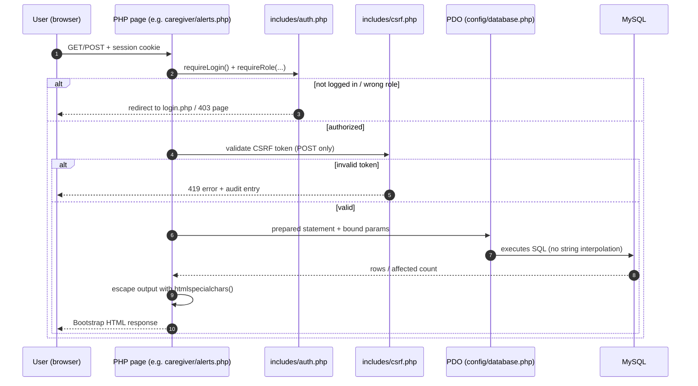
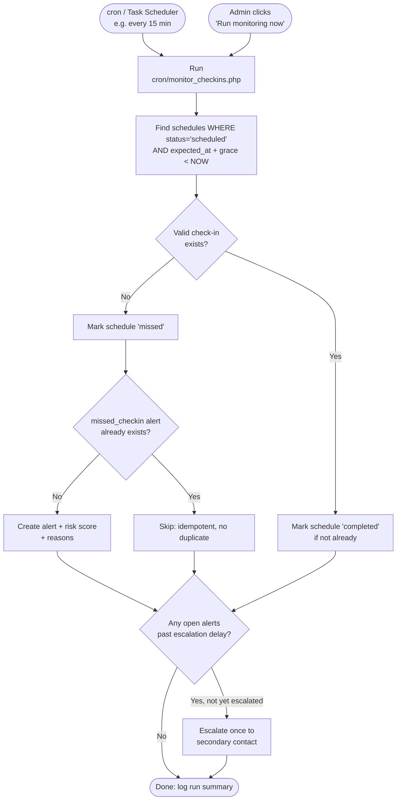
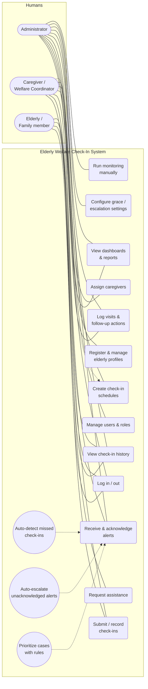
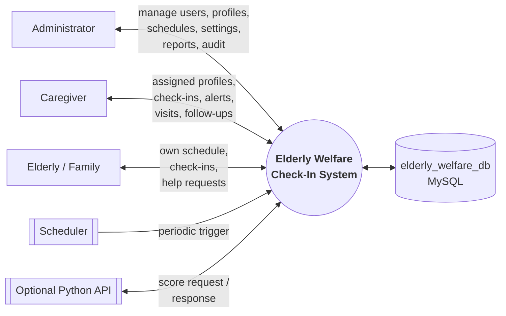
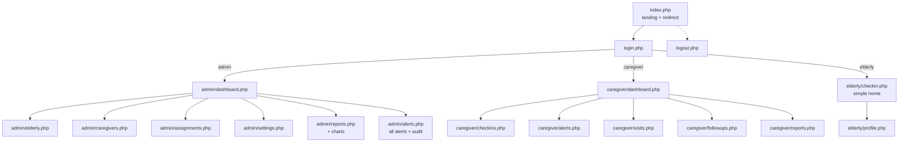

# Stage 1 — System Architecture & Design

> **Stage 1 deliverable 3 of 6.** Explains *how the parts fit together*:
> layers, request flows, background monitoring, use cases, data flows,
> folder rationale, and security architecture.
> Diagrams use [Mermaid](https://mermaid.js.org/) so they render on GitHub
> with no extra tools.

---

## 1. Architectural style (in plain English)

The system is a classic **3-layer web application** (also called
"presentation – application – data"):

1. **Presentation layer** — what the user sees: HTML + Bootstrap 5 + JS +
   Chart.js in the browser.
2. **Application layer** — what the server does: PHP scripts for pages,
   forms, sessions, business rules, the risk engine, and the monitoring
   script. Runs on **Apache** (via XAMPP).
3. **Data layer** — where records live: **MySQL/MariaDB** (`InnoDB`),
   accessed only through **PDO prepared statements**.

There is **no separate frontend framework** (no React/Vue) and **no ORM**.
This is deliberate: for a Year 2 project, plain PHP + PDO keeps every
database query visible and explainable, which makes security review
(prepared statements, escaping) straightforward.

A fourth element runs **outside** web requests:

4. **Background monitoring** — `cron/monitor_checkins.php`, a PHP CLI script
   triggered by cron (Linux/macOS) or Task Scheduler (Windows), plus a
   manual admin button that runs the same code. It never needs a browser
   page left open.

```
┌──────────────────────────────┐
│  BROWSER (Presentation)      │
│  HTML · Bootstrap 5 · JS     │
│  Chart.js · big-text elderly │
│  pages                       │
└──────────────┬───────────────┘
               │ HTTPS/HTTP: forms + session cookie
┌──────────────▼───────────────┐
│  APACHE + PHP (Application)  │
│  ┌────────────────────────┐  │
│  │ Pages: admin/ caregiver/│  │
│  │ elderly/ · login.php    │  │
│  ├────────────────────────┤  │
│  │ Shared: includes/auth   │  │
│  │ csrf, functions, header │  │
│  ├────────────────────────┤  │
│  │ ai/risk_engine.php      │  │
│  │ cron/monitor_checkins   │──┼──► cron / Task Scheduler (no browser needed)
│  └────────────────────────┘  │
└──────────────┬───────────────┘
               │ PDO prepared statements only
┌──────────────▼───────────────┐
│  MySQL / MariaDB (Data)      │
│  elderly_welfare_db (InnoDB) │
│  10 core tables + settings   │
└──────────────────────────────┘
```

### Why this architecture suits the project

| Concern | How the architecture addresses it |
|---|---|
| Undergraduate clarity | Each request = one PHP file; each query = visible SQL. Easy to explain in a viva. |
| Security | One auth include, one CSRF include, one PDO connection — no scattered logic. |
| Background work | Monitoring is a separate CLI entry point sharing the same includes (no duplication). |
| Optional ML | Python service (if built) sits *beside* PHP, not inside it — PHP keeps working if it is down. |
| Deployment | Copies straight into `htdocs/` on any XAMPP install; no build step, no Node.js. |

---

## 2. Request lifecycle (what happens when a user clicks)



**Key rules enforced on every request:**

1. `auth.php` runs **before** any data is touched.
2. `POST` actions validate CSRF **before** any write.
3. All SQL uses placeholders (`:id`, `?`) — never `"... $input ..."`.
4. All echoed data passes through `htmlspecialchars()` (via an `e()` helper).
5. Important actions append an `audit_logs` row in the same transaction
   where practical.

---

## 3. Background monitoring lifecycle (no browser needed)



The script is **idempotent**: running it 10 times in a row produces the
same database state as running it once (unique constraints + existence
checks guarantee this). This is tested explicitly in Stage 9
(test cases for duplicate prevention).

**Cron examples** (full instructions in Stage 6):

```bash
# Linux/macOS — every 15 minutes
*/15 * * * * /opt/lampp/bin/php /opt/lampp/htdocs/elderly-welfare-system/cron/monitor_checkins.php >> /var/log/ewm-monitor.log 2>&1

# Windows Task Scheduler — action:
#   Program: C:\xampp\php\php.exe
#   Arguments: C:\xampp\htdocs\elderly-welfare-system\cron\monitor_checkins.php
```

---

## 4. Optional ML extension — how PHP would call Python (design only)

```mermaid
flowchart LR
    PHP[PHP risk_engine.php] -->|POST localhost:5001/score<br/>+ shared secret header| PY[Python scikit-learn API<br/>optional, synthetic data only]
    PY -->|{score, reasons}| PHP
    PHP --> DB[(MySQL alerts)]
```

- PHP always computes its own rule-based score **first**.
- If the Python service is enabled **and** responds within a short timeout
  (e.g., 2s) with a valid secret, PHP may store the ML score **alongside**
  the rule score — never instead of it without a reason.
- If Python is down, slow, or disabled, PHP silently falls back to rules.
- The model trains only on **synthetic** data and is labelled
  "experimental, not clinically validated" everywhere it appears.

This design means the core project **cannot be broken** by the optional
extension — an important risk control for your demo.

---

## 5. Use-case diagram and catalogue

### 5.1 Diagram (Mermaid approximation)



> Notes: solid lines = primary actor; dotted lines = secondary/conditional
> (caregivers create schedules only for own assigned elderly;
> automated use cases extend alert handling).

### 5.2 Use-case catalogue (short form; full pre/post-conditions in report)

| UC | Name | Primary actor | Precondition | Main flow (abridged) | Postcondition |
|---|---|---|---|---|---|
| UC-01 | Log in / out | All human | Account exists, active | Enter credentials → session created, ID regenerated → role home. Logout destroys session. | Session exists (or destroyed); audit row. |
| UC-02 | Manage users & roles | Admin | Logged in as admin | Create/suspend/reset; role assigned; password hashed. | User row created/updated; audit row. |
| UC-03 | Register/manage elderly profiles | Admin | Logged in as admin | Enter profile fields → validate → save. Archive hides from lists. | Profile row; audit row. |
| UC-04 | Assign caregivers | Admin | Caregiver + elderly exist | Pick pair → set primary flag → save (unique pair enforced). | Assignment row; audit row. |
| UC-05 | Create check-in schedules | Admin (+ caregiver for own) | Elderly exists | Enter expected datetime, grace, escalation → validate → save `scheduled`. | Schedule row. |
| UC-06 | Submit/record check-ins | Elderly / Caregiver | Schedule exists (or ad-hoc) | Submit wellbeing + notes → server validates ownership → save; schedule → `completed`. | Check-in row; schedule updated. |
| UC-07 | View check-in history | All (scoped) | Logged in | Open profile → filter by date/status → paged list. | Read-only. |
| UC-08 | Receive & acknowledge alerts | Caregiver (+ admin) | Alert exists, assigned to me | Open alert → read reasons → acknowledge with note → investigate. | Acknowledgement row; alert `acknowledged`. |
| UC-09 | Log visits & follow-ups | Caregiver | Elderly/alert exists | Enter visit/follow-up → validate → save; resolve alert only with outcome. | Visit/follow-up rows; alert status updated. |
| UC-10 | View dashboards & reports | Admin, Caregiver | Logged in | Open dashboard → live aggregates; filter reports → Chart.js charts. | Read-only. |
| UC-11 | Configure settings | Admin | Logged in as admin | Edit grace/escalation defaults → validate ranges → save. | Settings rows; audit row. |
| UC-12 | Run monitoring manually | Admin | Logged in as admin | Click button (CSRF-protected) → same engine as cron runs. | Schedules/alerts updated; run logged. |
| UC-13 | Request assistance | Elderly/Family | Logged in, linked profile | Press "I need help" → confirm → assistance alert created (high priority). | Alert row; caregiver notified in-app. |
| UC-14 | Auto-detect missed check-ins | Monitoring engine | Cron/manual trigger | Find overdue → check evidence → mark missed → alert (idempotent). | Schedule + alert rows. |
| UC-15 | Auto-escalate | Monitoring engine | Open alert past delay | Find unacknowledged + past delay + not yet escalated → notify secondary once. | Alert `escalated`; timestamp + recipient. |
| UC-16 | Prioritize cases | Monitoring engine / page load | History exists | Apply documented rules → score + reasons → store with alert/assessment. | Priority + reasons stored. |

---

## 6. Data-flow diagram — Level 0 (context)



**Level-1 decomposition** (for your report's DFD chapter — processes only,
data stores in brackets):

1. `1.0 Authenticate users` (users, audit_logs)
2. `2.0 Manage profiles & assignments` (elderly_profiles, caregiver_assignments, users)
3. `3.0 Manage schedules & check-ins` (checkin_schedules, checkin_records)
4. `4.0 Monitor & score` (schedules, records, visits, alerts) — the cron process
5. `5.0 Manage alerts & escalation` (alerts, alert_acknowledgements)
6. `6.0 Record visits & follow-ups` (caregiver_visits, followup_actions)
7. `7.0 Report & audit` (all stores → dashboards, charts, audit_logs)

> Full Level-1/Level-2 DFDs with numbered flows will be drawn in your report
> document (draw.io / Lucidchart). The table above is the agreed process
> list so diagrams stay consistent with the code modules.

---

## 7. Page map (routes to be built in Stages 3–8)



> `admin/reports.php` and `caregiver/reports.php` are small additions to the
> required folder structure (reporting was listed as a page in §13 but had
> no file). This is the only structural addition, and it is documented here
> as required. Everything else matches the specified layout exactly.

---

## 8. Security architecture

| Threat | Control (where) |
|---|---|
| SQL injection | PDO prepared statements everywhere (`config/database.php` + all queries); no string-built SQL. |
| Password theft | `password_hash()` (bcrypt/argon2 default) at rest; `password_verify()` at login; no plain-text storage or logging. |
| Session hijacking/fixation | `session_regenerate_id(true)` at login; `HttpOnly` + `SameSite` cookie flags; inactivity timeout (~30 min); full destroy at logout. |
| CSRF | Per-session token (`includes/csrf.php`); validated on every POST; token rotated periodically. |
| XSS | `e()` helper (`htmlspecialchars(..., ENT_QUOTES, 'UTF-8')`) on all dynamic output; no raw echo of user data. |
| Broken access control | `requireRole()` + ownership checks (`assigned_to_me()`, `own_profile()`) at the top of every page/action; caregivers' queries always join assignments. |
| Privilege escalation | Role is read from the **server session + DB**, never from a form field or cookie the user can edit. |
| Duplicate/replay writes | Unique DB constraints + POST-redirect-GET + idempotent monitor. |
| Sensitive data exposure | Generic login error ("Invalid email or password"); no stack traces to users; secrets in untracked config; audit logs exclude passwords. |
| File upload abuse | No uploads in core scope. If added later: whitelist MIME/size/extension, random names, storage outside web root. |

** Defence in depth:** even if the UI hides a button, the server still
refuses the action — every test in Stage 9 includes a "direct URL / forged
POST" case for this.

---

## 9. Configuration & environments

| Item | Local (XAMPP) | Notes |
|---|---|---|
| PHP | 8.x bundled with current XAMPP | `password_hash()` defaults are safe on 8.x. |
| MySQL/MariaDB | Bundled; InnoDB engine | `utf8mb4` charset + `_ci` collation throughout. |
| Time zone | Single configured zone: `Africa/Lagos` (confirmed 2026-10-12) | Set in PHP (`date_default_timezone_set`) **and** MySQL session (`time_zone`) so deadlines compare correctly. |
| Web root | `C:\xampp\htdocs\elderly-welfare-system\` (Win) or `/opt/lampp/htdocs/…` | Never place `config/database.php` secrets in git — use `database.example.php` template (Stage 2). |
| Scheduler | Task Scheduler (Win) / cron (Linux/macOS) | Same PHP binary as XAMPP to avoid version mismatch. |

---

*Next: `04-database-design.md` — full table design, constraints, indexes,
and the Entity-Relationship Diagram.*
