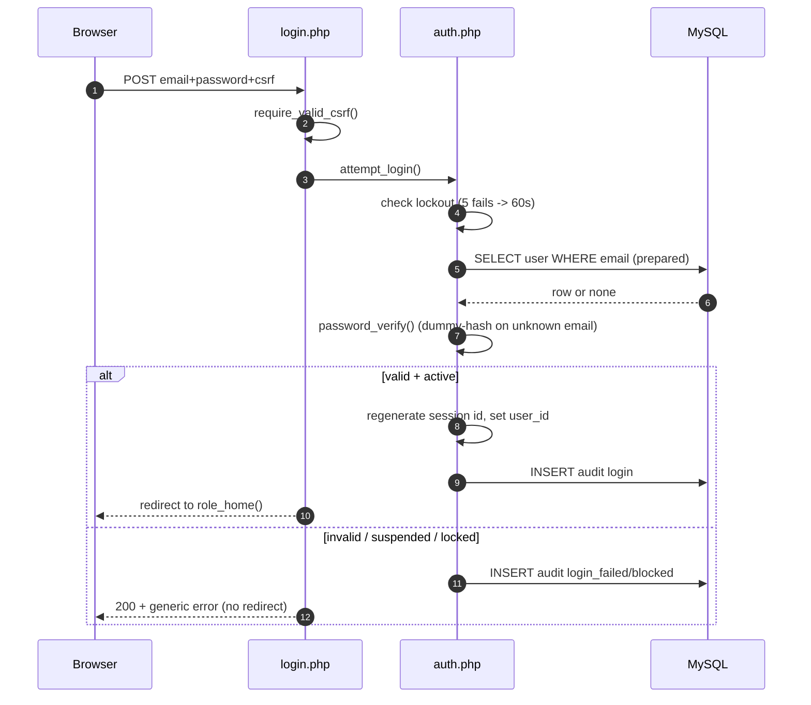

# Stage 3 — Authentication & Roles (login, sessions, RBAC, CSRF)

> **Stage 3 deliverable.** Builds the locked doors before any rooms: nobody
> reaches household, alert, or report pages until this stage works.
> Prerequisite: Stage 2 green (`elderly_welfare_db` imported, 5 demo users).

**Files created in this stage** (exact paths — all committed):

| File | Purpose |
|---|---|
| `includes/functions.php` | `e()` escaper, `redirect()`, flash messages, `audit()`, `is_safe_next()` |
| `includes/csrf.php` | Per-session token: `csrf_token()`, `csrf_field()`, `require_valid_csrf()` |
| `includes/auth.php` | Hardened sessions, `attempt_login()`, `logout_user()`, `current_user()`, `require_login()`, `require_role()`, `role_home()` |
| `includes/header.php` / `footer.php` | Shared Bootstrap layout, role-aware navbar, flash display (logout = POST form) |
| `assets/css/app.css` / `assets/js/app.js` | Large-text elderly styles, priority badges, confirm-dialog + flash helpers |
| `assets/css/bootstrap.min.css`, `assets/js/bootstrap.bundle.min.js` | Bootstrap 5.3.8 bundled locally (works offline; MIT licence) |
| `index.php` | Public landing page (redirects logged-in users to their role home) |
| `login.php` | Login form + credential check + safe `?next=` return |
| `logout.php` | POST+CSRF logout (GET shows a confirmation button) |
| `admin/dashboard.php`, `caregiver/dashboard.php`, `elderly/checkin.php` | **Placeholders** proving role routing — full versions in Stages 5/8 |

Deleted in this stage: `test_db.php` (Stage 2 verification is done; keeping a
database-info page would be a disclosure risk). If you ever need it back:
`git show 77df774:test_db.php > test_db.php`, use it, delete it again.

---

## A. How authentication works (the 5 ideas to understand)

### 1. Passwords: hash on write, verify on read — plain text never rests
- Creating a user (Stage 4 does this in a form): `$hash = password_hash($pw, PASSWORD_DEFAULT);`
  then store `$hash`. `PASSWORD_DEFAULT` currently means bcrypt cost 10.
- Logging in (`auth.php::attempt_login()`): `password_verify($typed, $row['password_hash'])`.
- Generate a hash by hand any time with XAMPP's PHP:
  `C:\xampp\php\php.exe -r "echo password_hash('Secret123!', PASSWORD_DEFAULT), PHP_EOL;"`
- The seed hashes in `elderly_welfare.sql` are real bcrypt hashes verified
  against `Admin123!` / `Care123!` / `Elder123!` (see Stage 2 commit checks).

### 2. Sessions: the server remembers you, the cookie is just a ticket
- `session_start()` (with `HttpOnly` + `SameSite=Lax` + `Secure`-on-HTTPS
  cookie flags) issues a random session id; `$_SESSION['user_id']` is the
  only identity stored — the role is re-read from MySQL on every request.
- `session_regenerate_id(true)` at login kills **session fixation**
  (an attacker pre-setting your session id is useless — login mints a new one
  and deletes the old file).
- Idle timeout (30 min, sliding): `current_user()` compares `last_activity`;
  expired sessions are destroyed and treated as guests.

### 3. RBAC: the server checks every page, not the menu
- Pattern on every protected page: `require_role('admin', '../login.php')`.
- Guests → bounced to `login.php?next=<original URL>`; wrong role → **403**
  page + `access_denied` audit row. Code after the call never runs on failure.
- Suspended/deleted users are rejected **mid-session** too, because status
  is re-queried from the DB on each request (fail-closed).

### 4. CSRF tokens: proof the POST came from OUR form
- Random 64-hex-char token per session, embedded via `csrf_field()`,
  checked with timing-safe `hash_equals()` in `require_valid_csrf()`.
- Rotated at login (fresh token per session), kept stable across tabs.
- Applied to login, logout, and every later state-changing form.

### 5. Audit + safe errors: traceable but not leaky
- `login`, `login_failed`, `login_blocked`, `logout`, `access_denied`,
  `csrf_blocked` rows go to `audit_logs` (verify with
  `SELECT * FROM audit_logs ORDER BY id DESC LIMIT 10;`).
- Users see generic messages; real errors go to the Apache error log only.
- `?next=` return URLs pass `is_safe_next()` — `?next=https://evil.example`
  is silently dropped (open-redirect protection).

### Request flow (login → role home)


---

## B. Test table (run on XAMPP — record results for Stage 9)

Conventions: `TC-3.x` ids continue into the Stage 9 plan. "Actual/Pass" are
**your** columns — I claim nothing until you run these.

| ID | Feature | Preconditions | Input / action | Expected result | Actual | Pass? |
|---|---|---|---|---|---|---|
| TC-3.01 | Admin login | DB seeded, logged out | `admin@example.local` / `Admin123!` → Log in | Redirect to `admin/dashboard.php` + "Welcome back" flash | | |
| TC-3.02 | Caregiver login | Logged out | `ruth.caregiver@example.local` / `Care123!` | Redirect to `caregiver/dashboard.php` | | |
| TC-3.03 | Elderly login | Logged out | `mary.elderly@example.local` / `Elder123!` | Redirect to `elderly/checkin.php`, large-text layout | | |
| TC-3.04 | Wrong password | Logged out | Valid email + `Wrong123!` | Stay on login + "Invalid email or password." (generic) | | |
| TC-3.05 | Unknown email | Logged out | `nobody@example.local` / anything | Same generic message as TC-3.04 (no enumeration) | | |
| TC-3.06 | Suspended account | `UPDATE users SET status='suspended' WHERE email='peter.family@example.local'` | Correct password | "This account has been suspended…" (then revert to `active`) | | |
| TC-3.07 | Lockout | Logged out | 5 wrong passwords in a row, then 1 more | "Too many failed attempts… N seconds" | | |
| TC-3.08 | Guest bounces | Logged out | Open `/caregiver/dashboard.php` directly | Redirect to `login.php?next=…`; after login, land back on dashboard | | |
| TC-3.09 | Caregiver vs admin page | Logged in as Ruth | Open `/admin/dashboard.php` directly | 403 "Not allowed" + `access_denied` audit row | | |
| TC-3.10 | Elderly vs caregiver page | Logged in as Mary | Open `/caregiver/dashboard.php` directly | 403 + audit row | | |
| TC-3.11 | Admin vs elderly page | Logged in as admin | Open `/elderly/checkin.php` directly | 403 (admins use admin pages, not the elderly UI) | | |
| TC-3.12 | CSRF block | Logged in | POST to `logout.php` with no/invalid token (e.g., via a crafted form) | 419 "Invalid form token" + `csrf_blocked` audit; still logged in | | |
| TC-3.13 | GET logout safe | Logged in | Open `logout.php` by URL (GET) | Confirmation button shown; session NOT destroyed until POST | | |
| TC-3.14 | Logout works | Logged in | Navbar Log out (POST) | Redirect to login + "logged out" flash; opening any dashboard bounces to login | | |
| TC-3.15 | Session fixation | Logged out | Note `PHPSESSID` cookie → log in → compare | Cookie value CHANGED after login (regenerated) | | |
| TC-3.16 | Idle timeout | Logged in | Temporarily set `SESSION_TIMEOUT_SECONDS` to 10 in `auth.php`, wait 15 s, reload | Bounced to login (then restore 1800) | | |
| TC-3.17 | Open redirect | Logged out | Open `login.php?next=https://evil.example` → log in | Lands on role home, NOT evil.example | | |
| TC-3.18 | Audit trail | After TC-3.01–3.14 | `SELECT action, COUNT(*) FROM audit_logs GROUP BY action` | Contains `login`, `login_failed`, `logout`, `access_denied` rows; no password text anywhere | | |
| TC-3.19 | No plain passwords | Any | `SELECT password_hash FROM users` | All values start `$2b$10$…` (60 chars), none readable | | |
| TC-3.20 | Mobile layout | Any | Open login + dashboards at 375 px width | No horizontal scroll; navbar collapses to hamburger | | |

Quick SQL helpers for the tests above:
```sql
-- Suspend / restore a demo account (TC-3.06):
UPDATE users SET status='suspended' WHERE email='peter.family@example.local';
UPDATE users SET status='active'    WHERE email='peter.family@example.local';
-- Inspect the trail (TC-3.18): SELECT id, user_id, action, entity_type, entity_id, details, ip_address, created_at FROM audit_logs ORDER BY id DESC LIMIT 15;
```

---

## C. Troubleshooting

| Symptom | Cause → fix |
|---|---|
| "Headers already sent" | Output before `redirect()` — check for blank lines/spaces before `<?php` or echoed text above the call. |
| Login loops back to login | Sessions not writing: check `session.save_path` is writable; on Linux `/opt/lampp/temp` needs write permission. |
| 404 on `assets/...` | Wrong `$rootPrefix` — root pages use `''`, subfolder pages use `'../'`. |
| 419 on every form | Session cookie blocked (private mode / clock skew) or double-submit after login rotated the token — reload the form page first. |
| Styles missing offline | You deleted `assets/css/bootstrap.min.css` — restore from git (`git checkout HEAD -- assets/`); no CDN is used, so offline is fine otherwise. |
| `password_verify` fails for seed users | Re-import `elderly_welfare.sql` fully (partial imports can truncate the hash column); hashes are 60 chars. |

---

## D. Viva Q&A (one-line answers to memorise)

1. **Why `password_hash`, not MD5/SHA-256?** — bcrypt is slow + salted per
   password; MD5/SHA are fast and crackable with rainbow tables/GPUs.
2. **Why `password_verify` with a dummy hash for unknown emails?** — keeps
   response time identical so attackers can't probe which emails exist.
3. **Why regenerate the session id at login?** — defeats session fixation.
4. **Why `HttpOnly` + `SameSite=Lax`?** — stolen-via-XSS and cross-site
   forged requests are both mitigated at the cookie layer.
5. **Why re-query the user on every request?** — suspension/deletion takes
   effect immediately, even mid-session.
6. **Why is logout POST+CSRF, not a link?** — GET links can be triggered by
   attackers (``); POST+token cannot.
7. **Why generic login errors?** — "wrong password" vs "no such user" would
   let attackers harvest registered emails.
8. **Is hiding buttons access control?** — No. Every page enforces
   `require_role()` on the server; try the direct URLs in TC-3.09–3.11.

---

## E. Stage 3 checklist & gate

- [x] `password_hash()` storage (seed) + `password_verify()` login (FR-01)
- [x] Hardened sessions: regenerate at login, idle timeout, secure flags (FR-02)
- [x] Server-side RBAC on every page + 403 handling + mid-session suspension (FR-03/04/05)
- [x] CSRF tokens on all state-changing forms incl. login/logout (FR-06)
- [x] Basic lockout + full audit of auth events, no secrets logged (FR-07/46)
- [x] Shared layout + offline Bootstrap + role homes (placeholders)
- [x] Static verification here: include graph, required functions, CSRF on all POST forms, no plain-text credentials (see commit); live TC-3.01–3.20 are YOUR runs
- [ ] **Student action:** run TC-3.01–3.20 on XAMPP, fill Actual/Pass, keep screenshots
- [ ] **Student action:** confirm `test_db.php` is deleted locally too

**Stage 4 preview (Household & caregiver management):** `admin/elderly.php`
(register/list/edit/archive + search/pagination), `admin/caregivers.php`
(accounts + password resets), `admin/assignments.php` (assign/unassign +
primary flag), server+client validation, caregiver "own assignments only"
 scoping. Reply **"Approved — proceed to Stage 4"** when TC-3.01–3.20 pass
(or paste failures for diagnosis).
